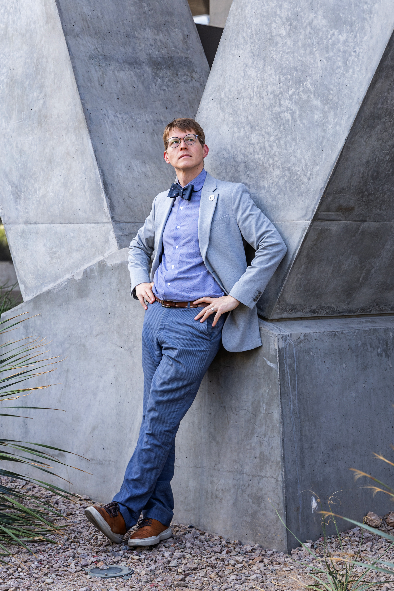

---
title: "Kristopher G. Klein"
title-block-banner: false
title-block-style: none
---

::: {.content-container}

:::: {.columns}

::: {.column width="35%"}

{width=85%}

### Kristopher G. Klein

**Associate Professor**  
University of Arizona  
Lunar and Planetary Laboratory

[GitHub](https://github.com/kgklein) · [ORCID](https://orcid.org/0000-0001-6038-1923) · [C.V.]((documents/Klein_CV.pdf))

[SciX](https://scixplorer.org/search?p=1&q=orcid%3A0000-0001-6038-1923&sort=date+desc&d=general) · [LPL Profile](https://lpl.arizona.edu/faculty/kristopher-klein)

:::

::: {.column width="65%"}

I am a space plasma physicist studying how energy is injected into, transferred through, and dissipated in weakly collisional plasmas. My research focuses on the solar wind as a useful laboratory for and other, more distant, space and astrophysical environments.

My group's work combines analytical theory, numerical modeling, and spacecraft observations to investigate the relationships between plasma turbulence, kinetic instabilities, and wave–particle interactions.

I am Deputy Principal Investigator of NASA's [HelioSwarm](https://science.nasa.gov/mission/helioswarm/) mission and Deputy Principal Investigator for the [SWEAP](https://sweap.cfa.harvard.edu/) investigation on [Parker Solar Probe](https://parkersolarprobe.jhuapl.edu/).

## Research

My research addresses three interconnected problems:

- **Turbulence and plasma heating:** How does turbulent energy cascade through scales and ultimately heat particles in environments with few collisionals?
- **Kinetic plasma physics:** How do nonthermal particle distributions drive instabilities, exchanging energy with plasma waves?
- **Multi-spacecraft measurements:** How can simultaneous observations reconstruct the three-dimensional, dynamic structure of turbulent plasmas?

[More research details here→](research.qmd)

## Publications and Software

My publications and open-source research tools are available below:

[Publications](publications.qmd) · [Software](software.qmd)

:::

::::
:::
